# Preach My Gospel App Database: AI + SQL

A natural-language interface to a MySQL database that models what missionaries track in the Preach My Gospel app: friends being taught, the ward members who help them, lesson appointments, completed lessons, commitments, referrals, and baptism dates.

You ask a question in plain English, and Google Gemini writes a read-only MySQL `SELECT` query. The query runs against the database once you confirm it, and Gemini then explains the result in plain English.

## How it works

1. `main.py` connects to MySQL. It creates the database if it doesn't exist, then loads the tables from `db_schema.sql` and the sample data from `db_data.sql`.
2. It reads the live schema from `INFORMATION_SCHEMA` and sends it to a Gemini chat session once. That prompt includes instructions and one business rule: *"actively progressing" means a lesson completed or a commitment kept in the last 7 days.*
3. For each question, Gemini returns SQL. You confirm it (Y/N) before it runs.
4. The rows that come back are sent to the same chat, and Gemini answers in plain language.

## Files

| File | Purpose |
|---|---|
| [main.py](main.py) | Chat loop: builds the schema prompt, calls Gemini, runs the SQL, and interprets the results |
| [db.py](db.py) | MySQL connection, schema creation, and sample data import |
| [db_schema.sql](db_schema.sql) | `CREATE TABLE` statements |
| [db_data.sql](db_data.sql) | Fictional sample data |
| [example_questions.md](example_questions.md) | Example questions with expected answers |
| [post.md](post.md) | Class post write-up |

## Setup

**Requirements:** Python 3.10+, MySQL 8.0, and a Gemini API key.

1. Create and activate a virtual environment, then install the dependencies:
   ```bash
   python -m venv venv
   venv\Scripts\activate        # Windows
   pip install -r requirements.txt google-genai
   ```
2. Create a `.env` file in the project root:
   ```
   DB_HOST=localhost
   DB_PORT=3306
   DB_USER=root
   DB_PASSWORD=your_password
   DB_NAME=pmg
   GEMINI_API_KEY=your_gemini_key
   ```
   `DB_NAME` must be `pmg`, because `main.py` reads the schema from the `pmg` database.
3. Make sure MySQL is running, then start the app:
   ```bash
   python main.py
   ```
4. Type a question, or type `quit` to exit.

## Database schema

```mermaid
erDiagram
    ward ||--o{ area_ward : ""
    area ||--o{ area_ward : ""
    ward ||--o{ address : ""
    address ||--o{ person : ""
    spoken_language ||--o{ person : ""
    person ||--o| friend_profile : ""
    person ||--o| member_profile : ""
    person ||--o{ person_relationship : ""
    area ||--o{ friend_profile : ""

    companionship ||--o{ companionship_member : ""
    missionary ||--|| companionship_member : ""
    companionship ||--o| companionship_assignment : ""
    area ||--o{ companionship_assignment : ""
    zone ||--o{ companionship_assignment : ""

    lesson_appointment ||--o{ appointment_friend : ""
    lesson_appointment ||--o{ appointment_member : ""
    lesson_appointment |o--o| lesson_appointment : "rescheduled_to"
    friend_profile ||--o{ appointment_friend : ""
    member_profile ||--o{ appointment_member : ""

    interaction ||--o{ interaction_friend : ""
    interaction ||--o{ interaction_member : ""
    friend_profile ||--o{ interaction_friend : ""
    member_profile ||--o{ interaction_member : ""

    lesson_appointment |o--o| lesson_session : ""
    interaction |o--o| lesson_session : ""
    lesson_session ||--o{ session_friend : ""
    lesson_session ||--o{ session_member : ""
    lesson_session ||--o{ session_lesson : ""
    lesson_session ||--o{ session_principle : ""
    friend_profile ||--o{ session_friend : ""
    member_profile ||--o{ session_member : ""
    lesson_catalog ||--o{ session_lesson : ""
    principle_catalog ||--o{ session_principle : ""

    friend_profile ||--o{ friend_lesson_completion : ""
    lesson_catalog ||--o{ friend_lesson_completion : ""
    lesson_session |o--o{ friend_lesson_completion : ""

    friend_profile ||--o{ friend_commitment : ""
    commitment_catalog ||--o{ friend_commitment : ""
    lesson_session |o--o{ friend_commitment : ""

    friend_profile ||--o{ referral : "referred"
    member_profile |o--o{ referral : "referred by"

    friend_profile ||--o| friend_baptism : ""
    area |o--o{ friend_baptism : ""
```




## Tables

### Places
| Table | Description |
|---|---|
| `ward` | A local congregation, such as "Cedar Ward". |
| `area` | A missionary teaching area. |
| `area_ward` | Many-to-many link between areas and wards, because an area can cover several wards and a ward can be split across areas. |
| `address` | A street address in a ward. Several people can share one address (for example, a family). |
| `spoken_language` | Languages a person can be taught in. |

### People
| Table | Description |
|---|---|
| `person` | Shared contact info for anyone in the system: name, phone, birth date, gender, address, and language. |
| `friend_profile` | A person being taught. Stores their area, when teaching started, how they were found, background notes, and `current_status` (`investigating`, `actively_teaching`, `stopped_teaching`, `lost_contact`, `baptized`). |
| `member_profile` | Marks a person as a ward member who can attend lessons and give referrals. |
| `person_relationship` | Family relationships between people (for example, sibling), stored once per pair. |

### Missionaries
| Table | Description |
|---|---|
| `missionary` | An individual missionary. |
| `companionship` | A group of missionaries who teach together. |
| `companionship_member` | Which missionaries are in which companionship. Each missionary is in exactly one companionship. |
| `companionship_assignment` | The current area and zone for each companionship. |
| `zone` | A group of areas overseen together. |

### Catalogs
| Table | Description |
|---|---|
| `lesson_catalog` | Standard and custom lessons, with a flag for lessons required for baptism. |
| `principle_catalog` | Gospel principles that can be taught within lessons, standard or custom. |
| `commitment_catalog` | Commitments that can be invited (for example, "Pray daily"), with a flag for ones required for baptism. |

### Appointments and contacts
| Table | Description |
|---|---|
| `lesson_appointment` | A planned lesson with a status (`scheduled`, `completed`, `canceled`, `rescheduled`). A rescheduled appointment points to its replacement. |
| `appointment_friend` | Friends invited to an appointment. |
| `appointment_member` | Members planning to attend an appointment. |
| `interaction` | Any contact event, such as a lesson, phone call, or member visit, with a type and timestamp. |
| `interaction_friend` | Friends involved in an interaction. |
| `interaction_member` | Members involved in an interaction. |

### Lessons taught
| Table | Description |
|---|---|
| `lesson_session` | A lesson that actually happened. It can link to the appointment it came from and to its interaction record, and has review notes. |
| `session_friend` | Friends who attended a session. |
| `session_member` | Members who attended a session. |
| `session_lesson` | Which catalog lessons were taught in a session. |
| `session_principle` | Which principles were taught in a session. |

### Progress
| Table | Description |
|---|---|
| `friend_lesson_completion` | When each friend completed each lesson (one row per friend and lesson), optionally linked to the session. |
| `friend_commitment` | One commitment extended to one friend: when it was extended, when it's due, its status (`pending`, `kept`, `not_kept`, `canceled`), and when it was kept. |
| `referral` | How a friend was referred, and by which member if any. |
| `friend_baptism` | A friend's baptism date: when it was set, the scheduled date, and the completion date and area once it's done. |
