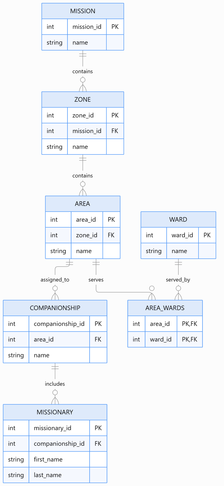
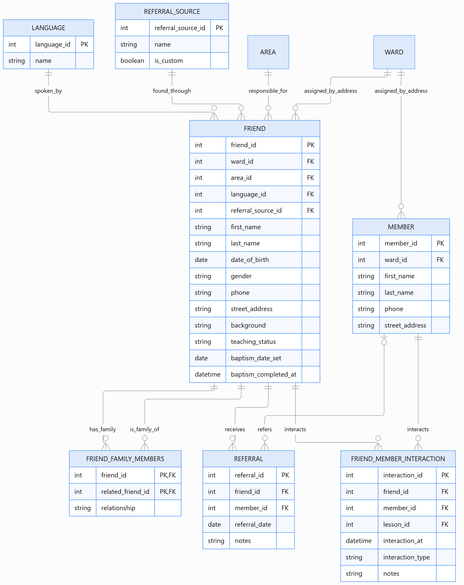
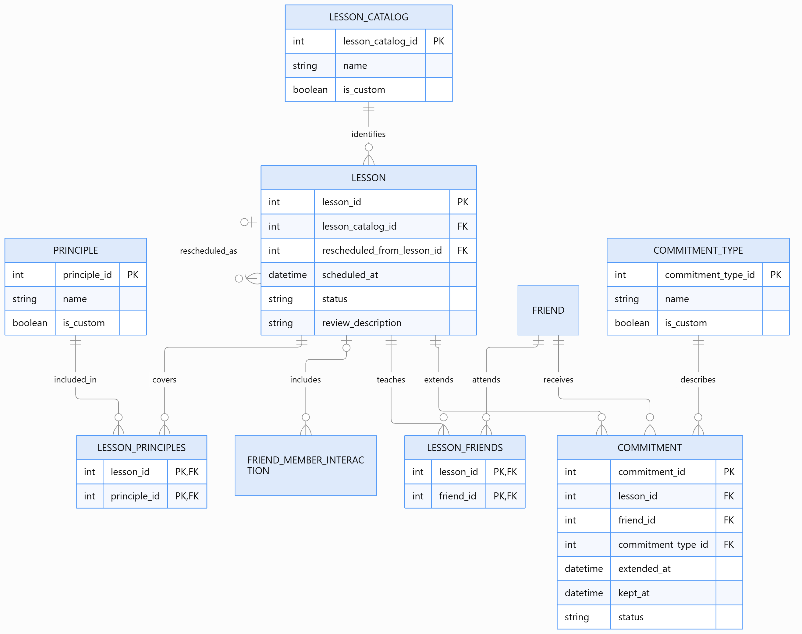

# Preach My Gospel App Database

My project models the data used and tracked by missionaries in the Preach My Gospel application. It covers the people being taught (friends) and the ward members who help them, along with lesson appointments, completed lessons, commitments, referrals, and baptism dates. The goal is for a missionary to ask plain-English questions like "Who is actively progressing?" or "Which lessons does Mia still need before baptism?" and get a plain-English answer.

**Code:** https://github.com/madalynkeyes/AI_SQL_Project
- [main.py](main.py): the chat loop (question → Gemini SQL → run on MySQL → Gemini friendly answer)
- [db.py](db.py): MySQL connection and schema/data loading
- [db_schema.sql](db_schema.sql) / [db_data.sql](db_data.sql): schema and fictional sample data
- [example_questions.md](example_questions.md): 6+ more example questions and results

**Model:** `gemini-3.1-flash-lite` through the `google-genai` Python SDK, with MySQL 8.0 as the database. This is the complete ERD split into three connected sections so the tables are easier to read. PK marks primary key; FK marks foreign key.

**Mission And Area Organization**


**Friends, Members & Referrals**


**Lessons, Principles & Commitments**


## How it works
1. When the app starts, it reads the live schema from `INFORMATION_SCHEMA` (tables, columns, types, primary and foreign keys) and sends it once, at the beginning of a Gemini chat session. It also tells Gemini to write only read-only MySQL `SELECT` queries and gives it one business rule: *"actively progressing" means a lesson completed or a commitment kept in the last 7 days.*
2. The user asks a question. Gemini returns SQL, and the user confirms before it runs.
3. The raw result rows go back into the same chat, and Gemini turns them into a friendly sentence.

## Query it did well on

**Question**: <!-- TODO: paste your question -->

**Gemini SQL Response**:
```sql
-- TODO: paste the SQL Gemini returned
```

**SQL Result**: <!-- TODO: e.g. [('Mia', 'Chen')] -->

**Friendly Response**: <!-- TODO: paste Gemini's interpretation -->

<!-- TODO: 1–2 sentences on why this was impressive (e.g. number of joins, using the junction tables correctly). -->

## Question that it tripped up on

**Question**: <!-- TODO -->

**Gemini SQL Response**:
```sql
-- TODO
```

**SQL Result**: <!-- TODO -->

**Friendly Response**: <!-- TODO -->

<!-- TODO: what you expected vs. what happened. Was the SQL wrong, or was the SQL right and the interpretation wrong? -->

## Prompting strategies
The paper ([Chang & Fosler-Lussier, 2023](https://arxiv.org/abs/2305.11853)) compares **zero-shot**, **single-domain** (few-shot examples from the same database), and **cross-domain** (few-shot examples from a different database) prompting.

- **Zero-shot**: My main approach. Gemini gets the schema, the instructions, and the business rule, but no example question/SQL pairs.
- <!-- TODO: if you tried single-domain or cross-domain, describe it here: what example(s) you added and whether results got better or worse. If you only tried zero-shot, delete this bullet. -->

One thing that helped was adding the "actively progressing" business rule to the prompt. That phrase isn't a column anywhere, so without a definition the model has to guess what it means.

## Conclusion
<!-- TODO: your takeaway. Some prompts to think about:
- How did it handle the many junction tables (session_friend, appointment_friend, etc.)?
- Did questions involving dates or "today" go well? (The sample data is from Sept–Oct 2026, so "last 7 days" depends on when you run it.)
- Would you trust it for a non-technical user? -->
